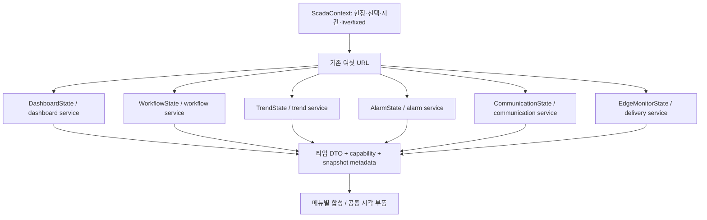

# 미니 SCADA 컴포넌트·레이아웃 설계

2026-10-28 · 오너 직접 지시 · **설계 완료 / stock 첫 이식 구현 / 실제 화면 수용 미실행**

첫 실제 이식 범위와 제약은 [템플릿 적용 기록](reflex_template_source.md)에 있다. 아래 표는 최종 목표 설계이며, 정본 자료가 없는 업무 실행·통신 이력·전달 지표는 미연결로 표시한다. 독립 SQL 대조와 빌드는 UI 시각 품질의 합격 근거가 아니다. 전용 Edge 기동이 자동 승인 검토에서 거부되어 실제 브라우저 수용은 NOT RUN이다.

우선 기준은 [메뉴별 시각화 계약](mini_scada_visualization_contract.md)이다. [공식 템플릿 28종 비교](reflex_template_catalog.md)를 거쳐 아래 조합을 선택했다. [설계 보드](mini_scada_layout_board.html)는 여섯 화면의 배치를 메뉴로 전환해 보는 오프라인 산출물이다. 보드의 점선·도형·`—`는 배치 설명이며 실제 운전 상태가 아니다.

## 1. 먼저 답할 운영 질문

|메뉴|사용자가 내려야 하는 판단|주 시각화|주 참조 / 보조 패턴|
|---|---|---|---|
|대시보드|어느 현장·설비를 먼저 확인할까?|주의 항목 우선 목록 + 설비군 상태 행 + 핵심 추이|stock_market의 비대칭 grid / account 그룹 행·company 소형 요약|
|워크플로우|이 실행이 어느 판단·조치 단계에서 멈췄나?|정의된 업무/제어 단계 그래프 + 실행 타임라인|ci 실행 목록·상태/기간 / 단계 그래프는 도메인 모델에 맞게 합성|
|트렌드|무엇이 언제 변했고 그 표본을 믿을 수 있나?|시간 축 그래프 + 품질/경보 레인 + 표본 근거|stock_graph의 헤더·차트 / nba 선택·brush·manufacturing 참조 표식|
|알람|무엇부터 대응하고 발생·복귀·확인은 어디까지인가?|우선순위 사건 목록 + 선택 사건 상세/타임라인|admin의 목록·상세 / table의 필터·페이지|
|통신 상태|어느 채널이 언제 끊기고 회복됐나?|채널×절대시각 히트맵 + 시도/응답 근거|retention의 행렬/셀 / 읽기 전용 구간 상세|
|Edge 관제|자료 전달의 어느 구간에서 지연·누락·격리됐나?|전달 단계별 관측치 + backlog/lag 추이 + 대조 표|stock_market의 비대칭 grid·밀도 / table 근거 표·native 상세 drawer|

워크플로우의 관계는 **측정→판단→시뮬레이션/승인→조치→피드백**이다. Edge 관제의 관계는 **Edge→전달기→Kafka→Consumer→상위 DB**다. 통신 상태는 장치/채널의 연결 이력이다. 이 세 화면이 같은 파이프라인을 다른 이름으로 반복하지 않게 한다.

## 2. 선택 이유와 반증 조건

|선택|비교한 대안|선택 근거|이 선택을 바꿀 조건|
|---|---|---|---|
|stock_market 공통 외형|dashboard/company/futuristic 전체 복제|오너 선택, 상단 탐색·비대칭 표/차트·작은 헤더가 관제 밀도에 맞음|1366px에서 핵심 열의 단위/시각이 읽히지 않으면 열을 숨기기보다 본문 비율·보조 패널을 조정|
|stock_graph + native Recharts|account 그래프, manufacturing 전체 SPC|현재값·기간·상태 분리의 완성도가 높고 기존 VQT에 직접 연결 가능|목표 브라우저에서 필요한 시간 동기화/누락 표시/부하 기준을 못 맞추면 격리 시험으로 다른 엔진 비교; 지금 새 엔진 추가는 하지 않음|
|admin 8:4 목록·상세|admin_panel 큰 CRUD 표, table 전폭만|알람 목록을 유지하며 선택 사건의 상태·근거를 비교 가능|좁은 화면에서는 상세를 아래 또는 drawer로 바꿈; 사건 목록 전체를 다시 덮어쓰지 않음|
|retention 셀 표현만|성공률 donut·상태 카드 나열|단절의 위치/지속/동시성을 직접 비교 가능|시도 이력이 없으면 성공률 heatmap을 만들지 않고 관측 자료 미연결로 표시|
|native 표 한 체계|템플릿별 표·pandas·추가 grid 혼용|현재 106점 및 페이지당 제한 사건은 의미 있는 열·정렬·선택이 우선|실측한 대량 행/셀 성능이나 필요한 고급 편집이 native 표로 충족되지 않을 때 전용 grid를 별도 비교|
|업무 단계 합성|retention의 Workflow 탭, space의 장식 연결|공식 예제에 요구한 실행 DAG가 없음; 원천 모델/실행 ID가 먼저 필요|정본 실행 엔진이 제공하는 검증된 그래프가 생기면 해당 계약/접근성/읽기 전용 범위를 검토|

템플릿 전체 교체 비용을 줄이기 위해 기존 조회 서비스의 site 격리·NULL/품질/시각 계약을 유지한다. 예제 State, random/Faker/yfinance, 외부 LLM, CRUD, 무한 폴링을 제품으로 가져오지 않는다.

## 3. 공통 외형과 정보 위계

**1440×900 설계 기준.** 상단 주 탐색 56px, 메뉴별 context bar 최소 56px, 본문 여백 24px, 12열·16px gutter. 1200px 이상은 아래 비율, 768–1199px는 두 구획, 768px 미만은 판단 순서대로 한 열이다. CSS `minmax(0,1fr)`·명시적 `grid_template_columns`를 사용하며 숫자형 `columns`에 커스텀 breakpoint 문자열을 넣지 않는다.

- 주 탐색은 기존 여섯 메뉴 이름/URL을 유지한다. 로고·탐색·선택 메뉴·사용자 영역을 한 줄에 둔다. 고정 폭 큰 사이드바와 거대한 페이지 제목으로 본문 폭을 빼앗지 않는다. 좁은 화면에서는 접는 메뉴로 전환한다.
- context bar는 현장, 메뉴에 필요한 설비/태그/기간, `실시간 조회 / 시점 고정`, 지금 조회를 담는다. 메뉴에 무관한 태그 선택기를 강제하지 않는다. source 최신 시각, 조회 기준 시각, 적재 시각은 다른 항목이다.
- 첫 줄 요약은 **한 개의 낮은 strip**으로 합성한다. 4개의 큰 독립 카드로 반복하지 않는다. 본문 section은 `제목+범위/시각+도구`, 구분선, 내용으로 구성한다. 카드 테두리는 선택·역할 경계가 있을 때 사용한다.
- 기본은 stock의 절제된 dark: page `#0B1018`, surface `#121A25`, raised `#182332`, border `#2B3748`, 본문 `#E6EDF6`, 보조 `#A6B4C5`, 상호작용 `#78A7FF`. 트렌드 계열색은 별도 고정 ID로 관리한다. 초록 면적 차트의 장식이 정상 판정을 뜻하지 않는다.
- 제목 20px/600, section 14px/600, 본문 14px, 보조·차트 축 최소 12px. 표 행 36px, 필터 최소 높이 36px, 모바일 터치 영역 44px. 숫자는 tabular-nums·우측 정렬·단위 분리, 태그/시간은 필요한 폭을 확보한다.
- 반짝임·장식 흐름 애니메이션·큰 그림자는 쓰지 않는다. 갱신 때 행/축/선택이 요동치지 않게 안정 ID와 범위를 유지한다. `prefers-reduced-motion`을 따른다. 색 외에도 글자/아이콘/선 형태로 상태를 구별한다.

### 의미를 분리하는 공통 부품

`QualityBadge(q)`·`FreshnessLabel(source_ts, policy)`·`LinkState(status, evidence_ts)`·`AlarmPriority(severity)`·`QueryState(status)`를 별개로 둔다. GOOD이고 오래된 자료, 연결됐지만 BAD인 값, 조회됐지만 Health가 없는 상태를 동시에 표현할 수 있어야 한다. 정책/분모 미수신은 회색 `미판정`이다. 증가=초록·감소=빨강 금융 규칙은 사용하지 않는다.

용어·의미색은 edgeEX 채택 용어표와 DS-017 §11.12도 대조했다. 기존 메뉴 이름/URL은 유지하되 본문은 경보·확인·양호/불확실/불량·갱신 지연으로 연결한다. 정상 연결 셀은 무채색, 통신/조회 오류는 state-fault 계열, 미완성/혼재는 state-caution, 경보 우선순위는 경보 전용 의미색이다. 트렌드의 계열색은 값의 정상 판정과 별개다. DS-017의 콘솔 레일 골격을 상위 SCADA에 복사하지 않고 오너가 선택한 stock 상단 탐색을 따른다.

`SectionFrame`은 시각 경계만 담당한다. 수치 계산·정상 판정은 넣지 않는다. 공통 `EvidenceDrawer`는 선택한 근거의 읽기 전용 항목·시각·식별자를 보여준다. SQL/접속정보/토큰은 표시하지 않는다. 데이터가 없는 기능은 해당 구획에 원인·필요 계약·가능한 다음 탐색을 표시하며 다른 메뉴의 전체 태그 표로 채우지 않는다.

## 4. 여섯 화면의 배치와 동작

각 행의 `8+4` 등은 본문 12열의 비율이다. 초기 상태에서 빈 값과 미연결 영역도 이 배치 안에 유지한다.

### D — 대시보드 `/`

|영역|배치|컴포넌트·내용|선택 이후|
|---|---|---|---|
|D1 요약|12열, 64px 내외|`OperationalSummaryStrip`: 정의된 현장/설비, 우선 확인 사건, 현재성, 품질을 짧게 표시. 정의 없으면 분모/상태 미판정|해당 필터를 가진 메뉴로 이동|
|D2 우선 확인|왼쪽 8열, 주 영역|`AttentionQueue`: 심각도·설비·원인·지속/발생 시각. 경보/통신/자료 신뢰도 원인을 별도 배지로 표시|사건/채널/태그에 맞는 상세, 동일 현장·시간 전달|
|D3 설비군|오른쪽 4열|`AssetGroupList`: 현장→설비군 접기·펼치기, 영향 수·원천 최신 시각|설비 워크플로우 또는 태그 선택; 이름으로 임의 매핑 금지|
|D4 핵심 지표|하단 8열|`KeySignalRows`: 정의된 핵심 신호의 값·단위·품질·소형 추이. 임의로 106점 중 첫 몇 개를 핵심으로 선정하지 않음|트렌드 해당 태그/동일 기간|
|D5 변화|하단 4열|`RecentOperationalEvents`: 실제 발생/복구/실행 상태 변화의 짧은 목록|관련 사건/실행 상세|

전체 태그 검색은 트렌드 selector와 Edge 근거 표에서 제공한다. 대시보드의 중심은 조사 대상을 고르는 일이다. 설비/핵심 지표 정의가 아직 없으면 D2에서 근거 있는 자료 경고만 표시하고 D3/D4는 모델 미연결로 남긴다.

### W — 워크플로우 `/workflow`

|영역|배치|컴포넌트·내용|선택 이후|
|---|---|---|---|
|W1 실행 선택|12열, 얇은 toolbar|정의/버전·설비·실행 ID·실행 시각. 최신 실행과 선택 실행 구별|실행 단위로 고정 조회|
|W2 단계 흐름|8열, 주 영역|`WorkflowRunGraph`: 정본 node/edge를 HTML/SVG로 합성. 노드에 단계명·상태·경과·근거 시각. 분기/대기/실패/미연결 표시|키보드/클릭으로 단계 선택|
|W3 단계 근거|4열|`WorkflowStepDetail`: 입력/출력 tag·판정/모델 버전·사유·승인 근거·조치 결과|입력 표본·트렌드·실제 실행 기록|
|W4 이력|12열|`WorkflowRunTable` + 선택 실행 timeline: 상태·시작/종료·지속·실패 단계|ci 실행 이력의 정보 밀도 적용|

실제 실행 event의 node_id/run_id/시각이 없으면 W2에 `업무 모델/실행 이력 미연결`을 표시한다. 설명용 개념 단계는 `개념도`로 명시하고 모두 회색으로 둔다. RUN/승인/PLC 출력 버튼은 이 읽기 전용 단위에 넣지 않는다. 단계 그래프에는 동등한 순서 목록과 단계 상세 접근을 제공한다. 원천 모델이 순환을 허용하면 피드백 edge의 의미와 반복 실행 ID를 먼저 정의한다.

### T — 트렌드 `/trend`

|영역|배치|컴포넌트·내용|선택 이후|
|---|---|---|---|
|T1 선택 신호|12열|`SignalHeader`: 태그명/ID·현재 값·단위·품질·원천 시각. stock_graph 헤더를 이식|검색형 다중 tag chip, 우선 4개 표시; 숨긴 계열도 명시|
|T2 조회/표현|12열, compact|지원 기간 5/15/60분·고정 범위·RAW/COND/FINAL·legend·조회 상태. 미지원 장기 기간 노출 안 함|조건 적용 1회 조회, live/fixed 의미 유지|
|T3 주 그래프|9열, 360px 이상|`TimeSeriesPanel`: stock_graph 얇은 grid·선/연한 area·정돈된 tooltip. 다른 단위는 별도 정렬 패널, 같은 단위만 비교 축 공유|시간 cursor/brush/선택 표본 상세|
|T4 표본 근거|3열|`SampleInspector`: source/ingested 시각, 원래 정밀도 값·q·reason·단계·식별자. 보정 전후 모두 표시|원시 표본/알람 연계|
|T5 신뢰 레인|T3 아래 9열|`QualityEventLane`: BAD/UNCERTAIN/결측/경보 구간, 잘림/보충 표식; 시간 축 공유|구간으로 좁혀 재조회|
|T6 범위 탐색|T5 아래 9열|`TimeRangeBrush`: 현재 받은 범위 내 축소; 범위 밖은 명시 조회|고정 시각 유지, 축 이동으로 자동 live 복귀 안 함|

연속값은 우선 linear, DI는 step-after, 결측은 끊는다(`connect_nulls=False`). 미수신 시 가짜 0 점을 만들지 않는다. 음수 허용, 표시 정밀도는 tag 계약을 따르고 원시 값은 보존한다. 축의 범위/단위/시간대·잘린 표본 수·집계 여부를 표시한다. RAW/COND/FINAL 동시 표시가 복잡하면 같은 시간 축의 분할 패널로 전환한다.

공통 cursor는 동일 인덱스가 아니라 원천 시각으로 맞춘다. 독립 갱신 tag를 같은 순간 측정했다고 합치지 않는다. 시각 차이·결측·최근접 매칭 오차를 드러내며 허용 오차 정책 없이는 값을 보간해 채우지 않는다. SPC 표식은 실제 적용된 규격/경보/관리 한계의 ID·버전·유효 기간이 있을 때만 구분 표시한다.

### A — 알람 `/alarms`

|영역|배치|컴포넌트·내용|선택 이후|
|---|---|---|---|
|A1 상태/필터|12열|현재 대응 / 발생 이력 tabs, severity·설비·원인·기간 검색; draft→적용/취소/reset|정의된 활성 상태 자료가 없으면 현재 대응은 capability 미연결|
|A2 사건 목록|8열, 주 영역|`AlarmIncidentTable`: 우선순위·설비/tag·발생·지속·복귀·확인 상태. sticky 헤더·안정 event ID·키보드 선택|선택 사건 상세 유지|
|A3 사건 상세|4열|`AlarmIncidentDetail`: 발생/복귀/ACK 별도 시각·주체·근거, 해당 시간 전후 trend|원천 사건과 같은 site/time로 이동|
|A4 하단|목록 아래 8열|건수/필터 범위/잘림·cursor 페이지·마지막 완료 조회시각|새 사건 도착 시 표시, 선택/스크롤을 강제로 맨 위로 옮기지 않음|

최근 100건은 제한된 이력이다. 이를 전체 활성 경보 수로 표시하지 않는다. 현재 제공되지 않는 severity나 원천 lifecycle을 문구/품질에서 추정하지 않는다. 인증·책임·서버 ACK 계약 전까지 읽기 전용. 빈 사건 목록과 조회 실패는 다르게 표시한다.

### C — 통신 상태 `/comm`

|영역|배치|컴포넌트·내용|선택 이후|
|---|---|---|---|
|C1 범위|12열|site·장치/채널·절대 기간·bin 크기, 상태 범례|모든 행이 같은 시간 경계를 사용|
|C2 연결 이력|9열, 주 영역|`ChannelTimeMatrix`: retention의 표 셀을 이산 상태로 이식. 행=채널, 열=시간. 정상/오류/혼재/미관측/계획 외를 글자/패턴으로도 구별|셀 선택으로 bin 상세|
|C3 구간 근거|3열|`ChannelIntervalDetail`: 마지막 정상·첫 오류·복구, 시도/응답/timeout, 오류 종류·원문 ID|원천 Health/attempt 기록 열기|
|C4 응답 추이|9열, 하단|실제 응답 지연과 오류 건수, 관측 범위·표본 수|분위수는 충분한 표본/정의가 있을 때만 표시|
|C5 영향|3열, 하단|해당 구간 tag 현재성·영향 경보 링크|연결 상태와 데이터 품질은 분리|

bin 성공률은 **정의된 수집 시도 분모**가 있을 때만 계산한다. 기대 표본은 계획 버전·가동/정지 구간을 반영해야 하며 VQT 행 수를 시도 수로 취급하지 않는다. 미관측을 정상 또는 실패로 채우지 않는다. 한 bin에 정상/오류가 섞이면 혼재로 표시하고 실제 transition 목록을 상세에서 보여준다. 장애 시작이 관측 범위 전이면 `이전부터 지속`으로 적는다.

### E — Edge 관제 `/edge-monitor`

|영역|배치|컴포넌트·내용|선택 이후|
|---|---|---|---|
|E1 전달 단계|12열|`DeliveryStageStrip`: Edge·forwarder·Kafka·Consumer·DB 각각 관측 기준·시각·처리량/확정 cursor. 각 단계에 자료 범위/미수신 표시|해당 단계/토픽/consumer 범위 선택|
|E2 backlog/lag|8열, 주 영역|`DeliveryLagPanel`: 같은 토픽/partition/group 단위 lag·처리·보충 추이, counter reset 구별|지연 구간 고정·offset 상세|
|E3 격리/보충|4열|`QuarantineBackfillSummary`: 격리 이유·재시도/보충 상태·마지막 사건. Health query 부재는 이 구획만 미연결|원문 읽기 전용 drawer|
|E4 점별 대조|8열, 하단|`DeliveryEvidenceTable`: site/tag·source_ts·단계/식별키·upper 도착·차이·중복/격리, 제한/페이지 명시|메시지/partition/offset/DB행 연결|
|E5 단계 근거|4열, 하단|`EvidenceDrawer`의 고정 패널 형태: source/received/committed 시각·범위·cursor·오류|같은 표본의 경로를 대조|

상위 DB 총 행 증가·Consumer commit 증가만으로 무손실/전 구간 정상 판정하지 않는다. 토픽별 fan-out, 재전송/중복, 보충 구간, 계약 밖 격리, 대상 site/tag 집합, 원천 표본 ID와 판정 경계를 먼저 맞춘다. 재부팅 counter·측정 주기·시계 오차가 다르면 수치를 단순 차감하지 않는다. `Health 미수신`과 `조회 실패`는 별도 상태이며 전체 페이지를 빨간 SQL 오류 박스로 덮지 않는다.

## 5. 데이터·State·컴포넌트 경계

`ScadaContext`는 공유 선택·시각만 소유한다. 한 State가 모든 메뉴의 최신106점+이력+알람+Health를 매5초 조회하는 현재 기술 기반을 메뉴별 서비스로 나눈다. 이 분리는 설계이며 기존 State가 이미 분리됐다고 보고하지 않는다.

|자료 계약|필수 필드/정의|현재 연결 상태와 구현 조건|
|---|---|---|
|`SnapshotMeta`|site, query_as_of, source 범위, completed_at, request_id, limit/truncated, capability별 상태|기존 VQT 서비스의 읽기 전용 snapshot 기반 유지|
|`TagDefinition`·`AssetBinding`|안정 ID, 종류/단위/정밀도/현재성 정책, 설비/핵심 지표/유효 버전|정본 전달 계약 미연결; 이름·값에서 추론 금지|
|`SignalSeries`|source_ts, ingested_ts, RAW/COND/FINAL nullable, q/reason, sample ID|일부 상위 VQT 조회 가능; 106점과 source time을 보존|
|`AlarmIncident`|event ID, severity, 발생/복귀/ACK와 주체/근거, tag/site|현재 최근 원천 이력 일부만 가능; 활성 전체/ACK 미연결|
|`WorkflowDefinition/Run`|node/edge·버전·run/step ID·입출력·상태 transition/시각|미연결; 시각 흐름이나 RUN 상태를 추정하지 않음|
|`ChannelAttempt/Transition`|channel ID·계획 버전·시도/응답/오류/시각·진단 ID|미연결; 저장된 VQT만으로 성공률 산출 불가|
|`DeliveryObservation`|단계·토픽/partition/group·관측 시각·cursor/counter 범위/reset·sample key·quarantine/backfill|단계 지표/Health 미연결, 상위 저장 표본은 일부 사용 가능|

서비스는 capability별 `available / empty / not_connected / unavailable / invalid_contract`를 반환한다. 필수 자료 실패는 해당 목적의 조회 실패, 선택 자료 실패는 해당 구획 실패다. 마지막 성공 응답을 보존하면 이전 자료임을 명시하고 갱신 실패를 함께 표시한다. 일부 오류를 0건·정상·빈 목록으로 바꾸지 않는다.

범위 변경은 `site+entity+window+mode+request_id`로 식별한다. 새 조건 뒤 늦게 온 이전 응답은 버린다. 한 메뉴의 오류가 다른 메뉴의 조회·메시지 흐름을 막지 않는다. 기존 유한 timeout/동시 조회 제한을 유지하고, 긴 I/O 동안 State lock을 잡지 않는다. read-only DB 트랜잭션만 사용한다. 숨겨진 메뉴는 자동 조회하지 않는다.

브라우저 tick은 live 메뉴의 유한 조회를 요청한다. fixed는 마지막 완료 snapshot과 범위를 보존하며 사용자가 적용/지금 조회할 때만 갱신한다. 커서/표 정렬/선택은 새 자료마다 초기화하지 않는다. live에서도 태그별 원천 시각 차이는 드러낸다. 서로 다른 메뉴의 개별 응답을 하나의 동시 snapshot으로 주장하지 않는다.

## 6. 검증 가능한 수용 기준

|ID|확인할 행동|반증·실패 조건|
|---|---|---|
|UX-D|주의 항목에서 같은 현장·대상·시간의 상세로 이동|근거 없는 정상 수치/잘못된 설비 매핑/모든 메뉴 같은 표|
|UX-W|선택 실행의 실패/대기 단계와 입출력 근거를 찾아감|실행 자료가 없는데 흐르는 정상 애니메이션/실행 상태|
|UX-T|실제0·음수·NULL·BAD·보정·시각 차이를 구별, 태그/기간 변경|0누락·음수 절단·NULL 연결·인덱스로 다른 시각 값 정렬|
|UX-A|한 사건의 발생/복귀/ACK가 구별되고 선택이 갱신 후 유지|최근100건을 전체 활성 건수로 표시·쓰기 없는 버튼을 승인처럼 표시|
|UX-C|채널×시간의 끊김/혼재/미관측을 근거와 대조|시도 분모 없이 성공률/회색 구간을 정상으로 표시|
|UX-E|같은 식별키/범위의 source·cursor·offset·upper행을 대조|총행/commit만으로 무손실 판정·Health 부재로 VQT 본문 전체 실패|
|UX-X|1440/1366/1024/768/390px, 키보드·축/표 단위·대비·빈/부분 실패|필수 열/단위 잘림·선택 focus 소실·색상만으로 판정|
|DATA-X|같은 읽기 snapshot을 독립 SQL로 대조, site/tag/time 변이 검출|UI PASS로 자료 계약 오류를 덮거나 기존 시험을 새 화면 수용으로 재사용|

성능 목표는 다음 이식 시험의 **잠정 예산**이다: 현재 106점/최대4개 표시 계열에서 사용자 필터/선택 피드백 200ms 이내, 조회 완료 후 화면 반영 1초 이내를 목표 브라우저에서 측정한다. 기존 조회의 8초 상한은 유지하되 새 성능 검증 통과로 간주하지 않는다. 다중 사용자 부하·장기 집계는 별도 기준/시험으로 정한다.

## 7. 구현 순서와 완료 경계

1. 공통 토큰·상단 탐색·SectionFrame·공통 상태/시각 부품을 하나의 체계로 이식한다. 미확정 light 실험을 정본 외형으로 취급하지 않는다.
2. 실제 VQT가 있는 트렌드와 Edge 점별 근거 표부터 stock 그래프·밀도·선택/tooltip을 검증한다. NULL/음수/실제0/지연 수신 사례를 포함한다.
3. 알람의 읽기 전용 이력을 목록·상세로 분리하고, 근거 있는 대시보드 우선 항목을 연결한다. 미연결 활성/설비 정의는 명시한다.
4. 정본 업무 모델·채널 attempt 이력·전달 단계 지표를 받으면 해당 메뉴의 정식 시각화를 연결한다. 그전에는 목적에 맞는 미연결 구획과 정의 요구를 유지한다.
5. 최종 제품 SHA에서 자료 대조·표적 시험·compile·메뉴별 화면/키보드·반응형 수용을 연결해 새 영수증을 만든다. 설계 보드·과거 기술 시험·부분 화면을 전체 UX 완료로 보고하지 않는다.

이번 변경은 문서·설계 보드·템플릿 목록이다. 운전 설치본·채널·전달기·Consumer·컨테이너·XG5000/SimCore 설정을 변경하지 않았다. PR#2는 기존 기술 기반 위의 WIP이며 이 설계의 제품 구현·운전 배포 완료를 의미하지 않는다.
